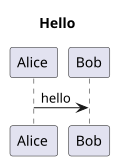

= Test spec
include::_fpsot-terms.adoc[]

[[TST-001]]
A test page MUST exist.
The {abbr-api-first} of the {term-registry} returns pages.
Each {abbr-api} call is short.

See xref:../../docs/modules/en/pages/index.adoc[the guide].

// These hosts refuse automated readers, so the link check skips them.
See link:https://www.iso.org/standard/78907.html[ISO 24495-1] and link:https://www.legisquebec.gouv.qc.ca/fr/document/lc/C-11[the Charter].
See also link:https://www.canada.ca/en/government/system/digital-government/policies-standards/policy-service-digital-announcements/direction-information-communication-technologies-accessibility-towards-regulatory-implementation.html[the federal direction].

== Document history

|===
|Version |Date |Change
|0.1.0 |2026-11-02 |First version.
|===
